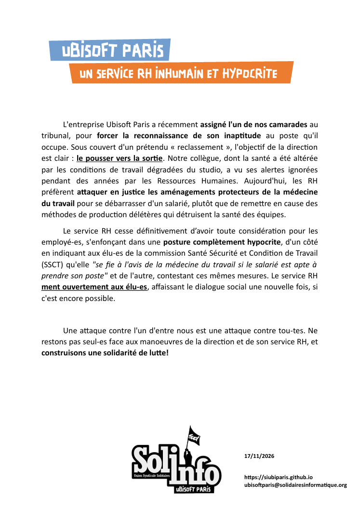

L'entreprise Ubisoft Paris a récemment assigné l'un de nos camarades au tribunal, pour forcer la reconnaissance de son inaptitude au poste qu'il occupe. Sous couvert d'un prétendu « reclassement », l'objectif de la direction est clair : le pousser vers la sortie. Notre collègue, dont la santé a été altérée par les conditions de travail dégradées du studio, a vu ses alertes ignorées pendant des années par les Ressources Humaines. Aujourd'hui, les RH préfèrent attaquer en justice les aménagements protecteurs de la médecine du travail pour se débarrasser d'un salarié, plutôt que de remettre en cause des méthodes de production délétères qui détruisent la santé des équipes.

Le service RH rompt définitivement toute considération pour les employé-es, s'enfonçant dans une posture complètement hypocrite, d'un côté en indiquant aux élu-es de la commission Santé Sécurité et Condition de Travail (SSCT) qu'elle "se fie à l'avis de la médecine du travail si le salarié est apte à prendre son poste" et de l'autre, contestant ces mêmes mesures. Le service RH ment ouvertement aux élu-es, affaissant le dialogue social une nouvelle fois, si c'est encore possible.

Une attaque contre l'un d'entre nous est une attaque contre tou-tes. Ne restons pas seul-es face aux manoeuvres de la direction et de son service RH, et construisons une solidarité de lutte!
