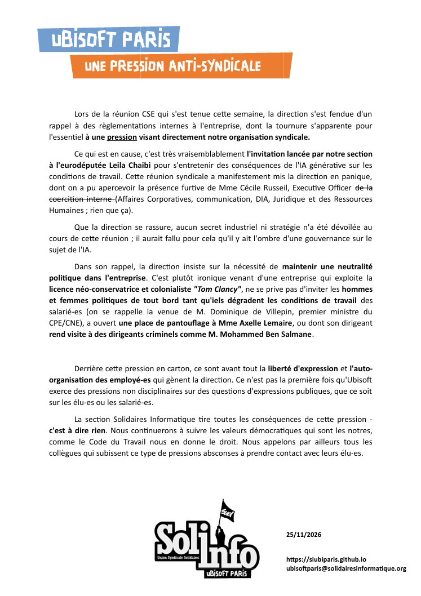

Lors de la réunion CSE qui s'est tenue cette semaine, la direction s'est fendue d'un rappel à des règlementations internes à l'entreprise, dont la tournure s'apparente pour l'essentiel à une pression visant directement notre organisation syndicale.

Ce qui est en cause, c'est très vraisemblablement l'invitation lancée par notre section à l'eurodéputée Leila Chaibi pour s'entretenir des conséquences de l'IA générative sur les conditions de travail. Cette réunion syndicale a manifestement mis la direction en panique, dont on a pu apercevoir la présence furtive de Mme Cécile Russeil, Executive Officer de la coercition interne (Affaires Corporatives, communication, DIA, Juridique et des Ressources Humaines ; rien que ça).

Que la direction se rassure, aucun secret industriel ni stratégie n'a été dévoilée au cours de cette réunion ; il aurait fallu pour cela qu'il y ait l'ombre d'une gouvernance sur le sujet de l'IA.

Dans son rappel, la direction insiste sur la nécessité de maintenir une neutralité politique dans l'entreprise. C'est plutôt ironique venant d'une entreprise qui exploite la licence néo-conservatrice et colonialiste "Tom Clancy", ne se prive pas d'inviter les hommes et femmes politiques de tout bord tant qu'iels dégradent les conditions de travail des salarié-es (on se rappelle la venue de M. Dominique de Villepin, premier ministre du CPE/CNE), a ouvert une place de pantouflage à Mme Axelle Lemaire, ou dont son dirigeant rend visite à des dirigeants criminels comme M. Mohammed Ben Salmane.

Derrière cette pression en carton, ce sont avant tout la liberté d'expression et l'auto-organisation des employé-es qui gènent la direction. Ce n'est pas la première fois qu'Ubisoft exerce des pressions non disciplinaires sur des questions d'expressions publiques, que ce soit sur les élu-es ou les salarié-es.

La section Solidaires Informatique tire toutes les conséquences de cette pression - c'est à dire rien. Nous continuerons à suivre les valeurs démocratiques qui sont les nôtres, comme le Code du Travail nous en donne le droit. Nous appelons par ailleurs tous les collègues qui subissent ce type de pressions absconses à prendre contact avec leurs élu-es.
